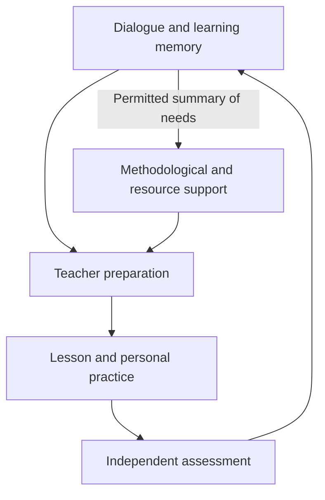

# From Personal Dialogue to School Development: A Pedagogical Architecture for a Local Intelligent Educational Ecosystem

**Authors:** Dmitry Drozdov, Dmitry Khairuzov  
**Version:** V0.7 · 9 November 2026  
**Type of work:** Conceptual study based on a targeted analysis of research literature and technical solutions

## Abstract

The ability of artificial intelligence to conduct an individual learning dialogue raises the question of how personal support can be connected with teachers’ work and the development of an educational organisation. This article proposes a pedagogical architecture for a local intelligent ecosystem serving a municipal network of schools. Its starting hypothesis is that coordinated work across three subsystems may improve educational quality by extending individual support into differentiated teaching and organisational decisions. The study combines a targeted literature analysis, functional modelling, and examination of synthetic scenarios. It describes the mechanism through which a difficulty identified in dialogue can lead to a choice of support, an independent action by the pupil, lesson preparation, and subsequent assessment. It defines the roles of revisable inter-session learning memory, dynamic grouping, and methodological support for teachers. The architecture includes specialised agent functions and shared services for execution, storage, and access control. A research programme is proposed in which educational outcomes are assessed through delayed independent performance on new tasks, while the effects of integration and multi-agent organisation are tested separately. The study’s output is a proposed theory of change and a functional model for further testing. Its educational effectiveness across a municipal network has not yet been established.

**Keywords:** personalised learning support; artificial intelligence; differentiated instruction; learning memory; multi-agent system; municipal education network; methodological support.

## 1. The problem and research question

A pupil and a teacher may understand the cause of a learning difficulty differently. An incorrect answer may reflect missing prerequisite knowledge, misunderstanding of a term, a slip, or an unsuccessful explanation. During a whole-class lesson, opportunities to clarify each cause are limited by the need to work with the entire class. A personal digital assistant can provide additional space for attempts, questions, and explanations. The educational value of that space, however, depends on what the pupil does and on how the interaction informs subsequent learning.

Suppose a pupil answers correctly after receiving a detailed hint. The assistant has completed the task, but questions remain for the teacher: which part of the solution did the pupil understand, which part followed a model, and what should be revisited in the next lesson? School leaders may need information about recurring difficulties, the adequacy of methodological support, and the results of actions already taken. A final grade alone cannot answer all these questions. What is needed is a link between the conditions under which work was completed, its pedagogical interpretation, a subsequent action, and an assessment of that action.

The proposed ecosystem brings together three areas. In the pupil subsystem, AI helps identify and address learning difficulties. In the teacher subsystem, it supports lesson preparation in light of specific learning needs. In the governance subsystem, it helps organise the conditions required for teaching and assess the consequences of decisions. A shared engineering environment enables these functions to operate within a controlled local setting.

**The aim of this article** is to develop a pedagogical and functional model of the links among the three subsystems. **The main research question** is: through what mechanisms can evidence from a personal learning dialogue inform teaching and organisational support so as to create conditions for deeper understanding and independent application of knowledge?

The main analytical output is a model of these mechanisms, transitions, and the conditions under which they may operate. The hypothesis that full integration provides additional benefit requires empirical testing. A shared interface or database, by itself, does not determine an educational effect.

## 2. Method of the conceptual study

The study combines three procedures: a targeted analysis of research, functional modelling, and examination of situations in which the proposed mechanism might fail. The search was conducted on 9 November 2026. Its themes included educational AI, dialogic support, independent performance after assistance, learning analytics, differentiation, inter-session memory, and organisational support for teaching. Related agent architectures and technical approaches to educational data exchange were also considered.

The materials include studies of educational outcomes, conceptual work, reviews, and official documentation [1–22]. Research on cognitive engagement and retrieval practice is also used for theoretical grounding. These source types serve different purposes: an experiment tests the effect of a defined intervention; a review helps assess the state of a field; conceptual work offers an explanation; and documentation describes available functions. Technical capability is not treated as evidence of pedagogical effect. The search was targeted and is not claimed to be an exhaustive systematic review. The search log and evidence matrix are maintained in the accompanying research dossier.

The unit of analysis is a pedagogical transition: for example, from a pupil’s answer to a hypothesis about a difficulty, or from a class summary to a change in an assignment. For each transition, the model specifies the initial evidence, the proposed mechanism, the action of the responsible participant, the outcome to be checked, and a possible failure. Synthetic scenarios are used to identify requirements and tensions. The study involved no real participants, field intervention, or original measurements.

## 3. What research suggests about educational AI

### 3.1. Successful performance with assistance and independent learning

In Bastani and colleagues’ high-school mathematics experiment, access to GPT-4 improved practice performance, but the basic assistant reduced subsequent performance when students no longer had access to the system. Specialised guardrails based on pedagogical hints substantially mitigated the negative effect; for that configuration, no positive effect on independent assessment was established [15]. Both results matter for system design: assistance can improve immediate performance, while the way it is provided can change its consequences for learning.

Positive results also depend on configuration and context. In a university study, Kestin and colleagues found that a specially designed AI tutor outperformed active learning in the experiment they examined [16]. That result concerns particular content, participants, and lesson arrangements. It supports further study of pedagogically designed assistance, but does not justify expecting the same effect from any chatbot in school.

This leads to an assessment principle: successful joint task completion is recorded as a characteristic of the interaction, while learning is checked through independent work. Retention and transfer to new tasks are especially important for our model. They should distinguish productive support from dependence on an assistant.

### 3.2. Changes in teachers’ work

Tutor CoPilot illustrates another route: AI helps a human choose pedagogical actions during instruction. In version 3 of the study, tutors’ access to the system increased the probability of passing an end-of-session assessment by four percentage points. No significant improvement was found on the year-end mathematics test [17]. The authors also observed changes in teaching strategies. Their study evaluates access to a support package; it does not establish the causal effect of each individual strategy.

This example matters for the link between the pupil and teacher subsystems. The quality of interaction may change through support for human decision-making. The transition from an immediate learning outcome to durable mastery remains a separate question. Our ecosystem therefore needs to test whether information about individual difficulties helps teachers prepare more suitable tasks and explanations, and whether pupils make independent progress when these materials are used.

Research on learning analytics dashboards shows that teacher awareness and the ability to take pedagogical action should be distinguished [2–4, 8]. A class summary should help select a next step, not merely display the distribution of responses.

### 3.3. Differentiation and school support

Differentiation by current readiness is considered a way to select tasks and scaffolds. Grouping alone, however, does not guarantee improvement. The Education Endowment Foundation synthesis notes that evidence on within-class attainment grouping is limited and heterogeneous; in the cited evidence base, a positive overall effect for secondary education was not established [19]. The number of levels, allocation rules, and content of support therefore need to be tested.

Organisational conditions may also affect teaching practice. The Embedding Formative Assessment programme includes teacher learning communities and structured peer observations. Its evaluation found a positive overall result on Attainment 8, but did not establish separate improvements in English and mathematics examinations [18]. This programme concerns professional support, not AI. For our study, it illustrates a possible link between how a school organises its work and educational outcomes.

Related agent architectures already include pupil, teacher, and institutional levels [5–6]. The proposed article therefore focuses on a specific mechanism connecting these levels and on how its value might be tested. The distinctiveness of this proposal requires further comparison with existing systems.

## 4. Personal dialogue as a pedagogical mechanism

### 4.1. Identifying the cause of a difficulty

The phrase “speaking the pupil’s language” needs an operational meaning. In the proposed model, it means identifying the pupil’s initial understanding, selecting an accessible explanation, and gradually moving towards disciplinary language. The assistant begins with the pupil’s attempt: it asks them to show a step, explain a choice, or compare two options. The response provides evidence for a hypothesis about the difficulty.

A single error is not enough to support a reliable conclusion. The assistant should distinguish among several plausible causes and choose a diagnostic task. For example, an error when comparing fractions may reflect the transfer of a rule for comparing whole numbers, a misunderstanding of the size of a fraction, or an accidental calculation error. A brief comparison using a visual representation, followed by an explanation of the choice, provides different evidence from simply repeating the original question.

Dialogue does not provide direct access to thought. Brief speech, silence, or an awkwardly worded response does not prove that the pupil lacks understanding. The pupil’s state should therefore be stored as a revisable hypothesis with its supporting evidence, to be checked through another task or a teacher’s judgement.

### 4.2. Selecting and gradually withdrawing support

After clarifying the difficulty, the assistant selects an action: a prompting question, a partial scaffold, a diagram, a worked example involving a different task, or a return to prerequisite knowledge. The pupil then completes the next step independently. If the pupil makes another error, the hypothesis or the support changes. If the pupil progresses, the assistance is reduced.

The pedagogical purpose of this cycle is to keep the intellectual work with the pupil. The pupil formulates an explanation, tests a hypothesis, corrects an error, or applies a relationship under new conditions. The number of messages and outward activity do not replace these actions. The ICAP framework helps distinguish forms of cognitive engagement [21], but it does not mean that every conversation with AI is a productive interaction.

Familiar interests and situations can serve as an entry point for an explanation. The boundaries of the analogy must then be made clear, and the explanation must move towards the general concept. A pupil who can reason only within one everyday story has not necessarily mastered the underlying disciplinary relationship. A new task in a changed context can test whether that transfer has occurred.

An explanation can be made more accessible by changing its language, number of steps, representation, or pace. The learning goal remains the same. A pupil’s preferences are used as context, not as a fixed “learning style”: there is insufficient evidence for assigning people to such categories [20]. For an advanced pupil, support may mean a counterexample, justification, or more demanding transfer task rather than more repetitions of the same exercise.

### 4.3. Memory between learning sessions

Personal memory extends pedagogical work over time. It links the learning goal, previous attempts, assistance provided, and results of subsequent checks. A record such as “completed the step after seeing a diagram; independent performance has not yet been checked” can inform the next action. A record such as “weak pupil” cannot.

The memory distinguishes confirmed events, provisional interpretations, interests reported by the pupil, and teacher decisions. Each record has a date and a basis. A previous difficulty is reconsidered in light of new evidence; successful work with a hint retains information about the support provided. The absence of a recorded hint does not rule out the use of an external tool, so independence requires separately arranged assessment conditions.

Returning to earlier material can support retrieval and checking of knowledge. Research on retrieval practice supports the importance of repeated testing for retention [22]. However, the added value of our particular inter-session memory must be tested separately: the same assistant, materials, and comparable learning time, with and without the history of previous sessions.

## 5. How personal support changes lesson preparation

Teachers need a picture of readiness for a specific topic. A class average can conceal different causes of error. Some pupils may need to revisit a prerequisite, others to practise applying it, and others to justify their reasoning. The system should show these differences together with the sufficiency of available evidence and the nature of earlier support.

The teacher assigns an assignment variant, using the system’s recommendation together with their own knowledge of the class. Three possible sets of work might include: prerequisite support and step-by-step scaffolds; a standard task with an explanation; and a deeper justification and transfer task. This is an organisational example. The number of variants depends on the topic, resources, and goals, and groups change as new evidence becomes available.

Task difficulty should be distinguished from the amount of support. Some pupils can work towards the same content goal with a diagram or an intermediate question. Permanently lowering the bar for one group risks entrenching a gap. Assessment of differentiation should therefore consider not only immediate correct answers, but also whether pupils can move towards the next level of independence.

A summary becomes a pedagogical tool when it leads to a concrete decision: change the explanation, use a different sequence of tasks, revisit a prerequisite, or offer an extension. The system records the reason for the decision and the version of the material. The teacher can reject or amend the recommendation. Such an amendment can help investigate the system’s suitability, but by itself does not establish the cause of the initial error.

Preparation, approval, and use of materials are separate stages. Only after the material has been used can subsequent pupil work be analysed. A new task should require the pupil to act independently rather than reproduce a worked answer. A delayed check complements an immediate one by showing what remains after assistance has ended.

## 6. The role of governance in the educational cycle

Personal diagnosis does not create time for additional work, methodological expertise, or access to equipment. The governance level is needed when a pedagogical decision depends on an organisational condition. For example, a recurring difficulty across several classes may justify collaborative material development, mentoring, or additional practice.

The proposed cycle includes identifying a need, discussing possible causes, deciding on support, implementing it, and assessing the result again. Governance receives information sufficient for its purpose. A summary does not automatically justify attributing a problem to a particular teacher: outcomes are also affected by prior preparation, attendance, conditions of assessment, and other circumstances.

Methodological support can be specific. Rather than a general demand to “improve quality,” staff can discuss a particular topic, type of difficulty, and possible action. The school allocates time and a mentor, then checks whether the material was used and whether independent work changed. The organisational measure is thus connected to a learning need.

Teacher attestation and professional competitions may draw on documented evidence of this work: resources developed, examples of their use, reflection, project records, and professional development. These are distinct organisational uses. A pupil-facing assistant should not steer learning towards a convenient reporting metric, and pupil achievements should not automatically be attributed causally to a single teacher.

Olympiads and research projects require another form of support. The system can help take account of interests, readiness, preparation stages, and prerequisite knowledge. It is also important to leave opportunities open to pupils whose potential has not yet become visible. In project work, a pupil’s independent contribution, mentor assistance, and AI use should be distinguished; the number of diplomas does not replace an assessment of development.

Reusing data can reduce duplicated work. For each governance field, its definition, source, period, and permitted recipient must be checked. Some information can come from learning activity; other information requires different sources. Missing data should remain visible. A completed report does not prove that the described action took place or had an effect.

## 7. Functional architecture and an end-to-end scenario

### 7.1. Components of the system

The architecture combines pupil, teacher, and governance subsystems on shared engineering infrastructure. “Local” means that processing and storage are located within a controlled environment; the specific topology depends on workload and operating conditions. Shared computing does not require shared access to all data.

| Subsystem | Main functions | Output for the shared cycle |
|---|---|---|
| Pupil | Dialogue, checking prerequisites, support for an independent step, revisable memory | Learning events with assistance conditions and grounds for interpretation |
| Teacher | Readiness analysis, preparation of work variants, review and approval of materials | An implemented pedagogical action and a plan for a new check |
| Governance | Methodological support, resource organisation, review of measures, document preparation | An implemented organisational decision and conditions for assessing it |
| Shared services | Retrieval from permitted materials, access control, versioning, calculation, queues, and recovery | Traceable execution and consistent state of results |

The municipal scale has a function of its own: several schools can jointly develop and reuse approved materials, arrange subject mentoring, and provide access to specialists or equipment unavailable at an individual school. Personal data are not assumed to move between schools by default; they are processed within permitted environments and authorities. Cross-school support uses only the permitted summaries it needs, while comparing outcomes requires comparable tasks, conditions, and participant populations. Similar indicators do not imply identical causes of difficulty. These conditions distinguish network design from simply duplicating a school server.

Specialised agents may prepare materials, critique subject content, retrieve supporting evidence, and draft explanations. Calculation of indicators, authority checks, and recording of approvals are performed by designated software services. A reviewing agent may make the same kind of error as the generator; separating roles does not establish independence of errors [7]. Multi-agent organisation should therefore be evaluated as a separate implementation option.

Existing standards and platforms provide a basis for event exchange, data provenance, learning plans, and transfer of results [9–14]. Applying them may be more practical than building every component from scratch. Yet compatibility of formats does not ensure that indicators carry the same pedagogical meaning. That requires agreement on conditions and transition rules.

*Figure 1. Proposed connection between the pedagogical and governance cycles. Arrows represent the transfer of relevant evidence and approved decisions; recipients are limited by their tasks and authority.*

### 7.2. Example of the shared cycle

Consider a synthetic example. A pupil compares fractions by looking at the denominator. The assistant asks the pupil to show what the fraction means and checks whether the error recurs in a different representation. After a prompting question, the pupil corrects the solution. The memory records the attempt, the scaffold provided, and the need for an independent check.

The teacher sees that some pupils in the class have a similar difficulty, while others are ready for the next step. The teacher selects an explanation comparing representations, adds scaffolds for the group that needs them, and gives justification tasks to those ready to extend their work. The system helps prepare the variants; the teacher reviews, assigns, and uses them in the lesson.

A new independent assignment refines the picture. If some pupils continue to struggle, the system does not declare the measure successful merely because it was delivered. The teacher revisits the hypothesis, and the school may organise methodological support or additional practice. The result of the next check returns to the cycle.

If an error is found in the original rubric, related states and summaries are reviewed. The corrected report receives a new version; a document already submitted requires a correction procedure in the receiving system. This helps maintain consistency, but the truth of the original pedagogical interpretation still needs to be checked.

### 7.3. Vulnerable transitions

| Transition | Condition for a productive link | Possible failure |
|---|---|---|
| Dialogue → interpretation | A diagnostic task distinguishes possible causes | The assistant cues the expected answer |
| Interpretation → support | The selected support preserves the pupil’s own effort | The system completes the task for the pupil |
| History → lesson preparation | The summary distinguishes needs from unknown conditions | The class average hides different difficulties |
| Material → learning | The material is used and the pupil attempts a new task | Preparation is mistaken for an outcome |
| Need → governance | The support measure is actually implemented | The system only sends a notification |
| New work → assessment of the measure | Assessment is independent and comparable | A familiar task is repeated or the rubric changes |

This table sets requirements for testing; it is not a measurement of system performance. In particular, the absence of errors on a limited set of examples does not guarantee their absence in operation.

## 8. A programme for testing educational outcomes

### 8.1. Primary outcome and the scope of educational quality

In the proposed system, educational quality includes understanding, retention, transfer, interest, and independence. A particular study needs one primary outcome. For the first educational evaluation, we propose the **score on a delayed, independent assessment using new tasks from a predefined learning module**.

The delay period, task set, rubric, and permitted supports should be fixed before the main comparison. Assessment tasks should be kept separate from the assistant during practice. Where possible, assessment should be scored without knowledge of the participant’s condition. Immediate checks, explanations of reasoning, and transfer to another context should be recorded separately; they should not be combined into an arbitrary total score.

Interest and self-regulation require suitable measurement instruments and observations, including planning, strategy choice, and checking one’s own errors. Chat duration, the pleasantness of the interaction, and the number of logins do not substitute for these characteristics. Teacher time savings remain an organisational outcome and must include review and correction time.

### 8.2. Separating component effects

An initial test of the pupil–teacher link could compare two configurations using the same personal assistant: in one, the teacher receives a structured picture of difficulties for lesson preparation; in the other, the teacher uses the information normally available. The base model, shared initial materials, learning goals, available time, and assessment conditions should be comparable. The tasks and explanations prepared by teachers may differ as part of the intervention; those differences should be recorded. This comparison estimates a particular form of information support for teaching.

If an intervention changes one teacher’s preparation, randomising that teacher’s individual pupils does not isolate the conditions. Assignment may be at class or teacher level, depending on how likely materials and practices are to spread between classes. Such spillover must be addressed in both the design and analysis. A feasibility pilot does not replace a sufficiently powered causal comparison.

The added value of memory should be tested in a separate contrast, with and without the history of previous sessions. Multi-agent organisation should be compared with a simpler configuration using the same data, tools, and resource limits. Comparing the entire package with usual practice may also be useful, but it does not separate the contributions of its parts.

Testing full integration requires conditions with partial connectivity. Organisational support may be assigned at the level of teacher groups or schools and operate for longer than one learning module. The design should therefore reflect the actual support measure and possible transfer of practice among participants. The best average result for the full configuration alone does not establish an interaction among component effects.

Sample size cannot be chosen for convenience. It requires an estimate of variation in the primary outcome, allowance for pupils nested within classes, anticipated missing data, and a minimally important improvement. A pilot can refine measurement and feasibility; the main comparisons need a prespecified analysis plan. Repeated tasks from one pupil are not independent participants.

### 8.3. Alternative explanations

Improvement may result from additional practice, interface novelty, adult attention, or better materials. These conditions should be recorded and, where possible, balanced. The study should also distinguish assignment to access from actual use, and account for non-participation and use of external AI.

The sequence “strategies changed, then outcomes improved” is consistent with the proposed mechanism but does not prove causal mediation. A teacher may choose a strategy in response to a difficulty. Process logs can help explain an effect, but testing individual mechanisms requires additional comparisons and assumptions.

An average improvement is not enough. Subgroups should be defined in advance on defensible grounds, and the analysis should check whether any pupils are worse off. Access to devices, interface language, and the availability of equivalent support for pupils who do not use the system deserve particular attention. These conditions concern research organisation, not characteristics of the child.

## 9. Discussion and limitations

The article’s central proposition is that identifying a difficulty through personal dialogue can continue in differentiated teaching and organisational support. Each link has its own condition: interpretation must be justified, materials must be used, support must be implemented, and outcomes must be checked independently. A weak link can limit the benefit of the entire system.

This makes the possible contribution more specific. General ideas of personalisation, formative assessment, and learning analytics are already established [1–6]. Our proposal connects them through revisable learning memory, lesson preparation, and assessment of governance measures. The distinctiveness of this contribution needs to be established through comparison with specific existing implementations and testing of the proposed mechanism.

Digital memory can preserve errors and reinforce low expectations. Grouping can restrict a pupil’s opportunities. Administrative interest in indicators can influence learning behaviour. For this reason, mastery criteria should not be changed to suit reporting, group assignments should be revisable, and data purposes and authority should be defined before work with real participants. Local deployment also requires a separate justification of security and lawful data processing.

The conceptual model does not cover the full complexity of school education. The study contains no field measurements, interviews with municipal stakeholders, or analysis of specific local procedures. The targeted search limits the completeness of the comparison with related systems. Results from individual studies do not establish the effectiveness of the proposed municipal system, and a positive effect on an immediate task does not guarantee durable learning.

A negative result may also be scientifically useful: for example, verifiable memory may help while multiple agents add no value, or lesson preparation may improve without transfer. Such results would help refine the mechanism and simplify the system. They should be preserved alongside positive results.

## 10. Conclusion

This article proposes a pedagogical architecture for a local intelligent ecosystem that connects personal support for pupils with teacher preparation and school governance. It describes a mechanism comprising identification of a difficulty, selection and gradual withdrawal of support, independent action, revision of learning memory, differentiated teaching, and a new assessment. The governance level creates conditions for implementing pedagogical decisions and assessing their consequences.

The article’s main output is a proposed theory of change and functional model that make it possible to move from a general expectation that AI will help towards testing specific links. The proposed programme places independent application of knowledge at its centre, distinguishing it from immediate success with hints, organisational savings, and the number of documents produced.

The next research step is to select a bounded learning module, agree on scenarios with teachers, and prepare a comparison that tests whether linking personal support with lesson preparation changes delayed independent performance. Further studies should examine the value of memory, organisational support, and multi-agent implementation while retaining the shared objective of improving pupils’ ability to understand and act independently.

## References

**[1]** Ninaus M., Sailer M. (2022). Closing the loop – The human role in artificial intelligence for education. *Frontiers in Psychology* 13:956798. DOI: https://doi.org/10.3389/fpsyg.2022.956798

**[2]** Kaliisa R., Jivet I., Prinsloo P. (2023). A checklist to guide the planning, designing, implementation, and evaluation of learning analytics dashboards. *IJETHE* 20:28. DOI: https://doi.org/10.1186/s41239-023-00394-6

**[3]** Karademir O. et al. (2024). I don't have time! But keep me in the loop: Co-designing requirements for a learning analytics cockpit with teachers. *JCAL* 40(6):2681–2699. DOI: https://doi.org/10.1111/jcal.12997

**[4]** Paolucci C., Vancini S., Bex R. T. II, Cavanaugh C., Salama C., de Araujo Z. (2024). A review of learning analytics opportunities and challenges for K-12 education. *Heliyon* 10(4):e25767. DOI: https://doi.org/10.1016/j.heliyon.2024.e25767

**[5]** Sharif M., Seker H. (2026). A context-aware multimodal multi-agent deep reinforcement learning framework for autonomous personalized education. *Discover Computing* 29:697. DOI: https://doi.org/10.1007/s10791-026-10639-3

**[6]** Spivakovsky O., Lemeshchuk O., Poltoratskyi M. (2026). Architecture of an enterprise artificial intelligence ecosystem in the digital transformation of a university. *ITLT* 115(5):208–224. DOI: https://doi.org/10.33407/itlt.v115i5.6832

**[7]** Cemri M. et al. (2025). Why Do Multi-Agent LLM Systems Fail? arXiv:2503.13657v3. DOI: https://doi.org/10.48550/arXiv.2503.13657

**[8]** Kaliisa R., Misiejuk K., López-Pernas S., Khalil M., Saqr M. (2024). Have Learning Analytics Dashboards Lived Up to the Hype? LAK ’24:295–304. DOI: https://doi.org/10.1145/3636555.3636884

**[9]** 1EdTech. Caliper Analytics 1.2 Specification, Final Release, 27 March 2020. https://www.imsglobal.org/spec/caliper/v1p2/

**[10]** Groth P., Moreau L. (eds.). W3C PROV-Overview. Working Group Note, 30 April 2013. https://www.w3.org/TR/prov-overview/

**[11]** Ed-Fi Alliance. Assessment Providers — Data Model. https://docs.ed-fi.org/getting-started/provider-playbook/specifics-by-provider-type/assessment-providers/domain-api-tutorial/assessment-providers-data-model/

**[12]** MoodleDocs 4.5. Learning plans, oldid=132094. https://docs.moodle.org/405/en/learning_plans

**[13]** MoodleDocs 4.5. Analytics, oldid=147985. https://docs.moodle.org/405/en/Analytics

**[14]** 1EdTech. OneRoster Planning and Procurement Guide. https://www.1edtech.org/standards/oneroster/OneRoster-Procurement-Guide

**[15]** Bastani H., Bastani O., Sungu A., Ge H., Kabakcı Ö., Mariman R. (2025). Generative AI without guardrails can harm learning: Evidence from high school mathematics. *PNAS* 122(26), e2422633122. https://doi.org/10.1073/pnas.2422633122

**[16]** Kestin G. et al. (2025). AI tutoring outperforms in-class active learning: an RCT introducing a novel research-based design in an authentic educational setting. *Scientific Reports* 15, 17458. https://doi.org/10.1038/s41598-025-97652-6

**[17]** Wang R. E., Ribeiro A. T., Robinson C. D., Loeb S., Demszky D. Tutor CoPilot: A Human-AI Approach for Scaling Real-Time Expertise. arXiv:2410.03017v3. https://arxiv.org/html/2410.03017v3. DOI: https://doi.org/10.48550/arXiv.2410.03017

**[18]** Education Endowment Foundation. Embedding Formative Assessment. Evaluation completed 2018. https://educationendowmentfoundation.org.uk/projects-and-evaluation/projects/embedding-formative-assessment

**[19]** Education Endowment Foundation. Within class attainment grouping. Teaching and Learning Toolkit. https://educationendowmentfoundation.org.uk/education-evidence/teaching-learning-toolkit/within-class-attainment-grouping/

**[20]** Education Endowment Foundation. Learning styles. Teaching and Learning Toolkit. https://educationendowmentfoundation.org.uk/education-evidence/teaching-learning-toolkit/learning-styles/

**[21]** Chi M. T. H., Wylie R. (2014). The ICAP Framework: Linking Cognitive Engagement to Active Learning Outcomes. *Educational Psychologist*. https://doi.org/10.1080/00461520.2014.965823

**[22]** Roediger H. L., Karpicke J. D. (2006). Test-enhanced learning: taking memory tests improves long-term retention. *Psychological Science* 17(3), 249–255. https://doi.org/10.1111/j.1467-9280.2006.01693.x

Date of access for electronic sources: 9 November 2026.
