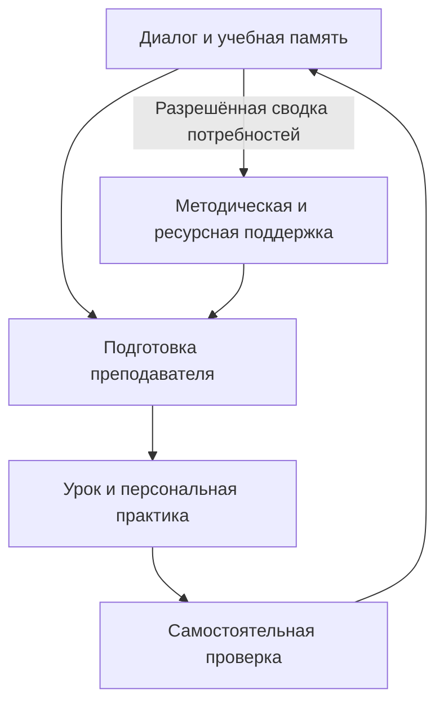

# От персонального диалога к развитию школы: педагогическая архитектура локальной интеллектуальной образовательной экосистемы

**Авторы:** Дмитрий Дроздов, Дмитрий Хайрузов  
**Редакция:** V0.7 · 09.11.2026  
**Тип работы:** концептуальное исследование на основе целевого анализа научной литературы и технических решений

## Аннотация

Возможность искусственного интеллекта вести индивидуальный учебный диалог ставит вопрос о том, как связать персональную помощь с работой преподавателя и развитием образовательной организации. В статье предложена педагогическая архитектура локальной интеллектуальной экосистемы муниципальной сети школ. Её исходная гипотеза состоит в том, что согласованная работа трёх подсистем может улучшать качество образования благодаря продолжению индивидуальной поддержки в дифференцированном преподавании и организационных решениях. Метод исследования объединяет целевой анализ литературы, функциональное моделирование и разбор синтетических сценариев. Раскрыт механизм перехода от выявления затруднения в диалоге к выбору поддержки, самостоятельному действию ученика, подготовке урока и последующей проверке. Определена роль пересматриваемой межсессионной памяти, динамической группировки и методической поддержки преподавателей. Архитектура включает специализированные агентные функции и общие сервисы исполнения, хранения и разграничения доступа. Предложена программа исследований, в которой образовательный результат оценивается по отсроченному самостоятельному выполнению новых заданий, а эффекты интеграции и многоагентной организации проверяются раздельно. Полученный результат — предлагаемая теория изменений и функциональная модель для дальнейшей проверки. Её образовательная эффективность в муниципальной сети пока не установлена.

**Ключевые слова:** персональная учебная помощь; искусственный интеллект; дифференцированное обучение; учебная память; многоагентная система; муниципальная образовательная сеть; методическая поддержка.

## 1. Исходная проблема и исследовательский вопрос

Ученик и преподаватель могут по-разному понимать причину учебного затруднения. Неверный ответ иногда связан с отсутствием необходимого знания, иногда — с непониманием термина, случайной ошибкой или неудачным способом объяснения. В общем ходе урока возможности уточнить каждую такую причину ограничены необходимостью работать со всем классом. Персональный цифровой помощник способен предоставить дополнительное пространство для попытки, вопроса и объяснения. Однако образовательная ценность этого пространства зависит от того, что делает сам ученик и как результаты взаимодействия продолжаются в дальнейшей учебной работе.

Предположим, школьник правильно ответил после подробной подсказки. Помощник завершил задачу, но для преподавателя остаются вопросы: какая часть решения была понятна, какая выполнена по образцу и к чему нужно вернуться на следующем уроке? Руководству школы могут потребоваться сведения о повторяющихся трудностях, достаточности методической поддержки и результатах принятых мер. Одна итоговая отметка не отвечает на все эти вопросы. Нужна связь между условиями выполнения, педагогической интерпретацией, последующим действием и его проверкой.

Предлагаемая экосистема объединяет три направления. В ученическом направлении ИИ помогает выяснять и преодолевать затруднения. В преподавательском — поддерживает подготовку урока с учётом конкретных учебных потребностей. В управленческом — помогает организовать условия, необходимые для педагогической работы, и оценить последствия решений. Общая инженерная среда обеспечивает выполнение этих функций в управляемом локальном контуре.

**Цель статьи** — разработать педагогическую и функциональную модель связи трёх подсистем. **Основной исследовательский вопрос:** через какие механизмы результаты персонального учебного диалога могут изменять преподавание и организационную поддержку, чтобы создавать условия для более глубокого понимания и самостоятельного применения знаний?

Основной аналитический результат работы — модель этих механизмов, переходов и условий их действия. Гипотеза о дополнительной пользе полного объединения подсистем требует эмпирической проверки. Само наличие общего интерфейса или базы данных не определяет образовательного эффекта.

## 2. Метод концептуального исследования

Работа объединяет три процедуры: целевой анализ исследований, построение функциональной модели и разбор ситуаций, в которых предполагаемый механизм может нарушаться. Поиск выполнен 9 ноября 2026 года. Тематические направления охватывали образовательный ИИ, диалогическую поддержку, самостоятельное выполнение после помощи, учебную аналитику, дифференциацию, межсессионную память и организационную поддержку преподавания. Дополнительно рассмотрены близкие агентные архитектуры и технические решения обмена образовательными данными.

Материалы анализа включают исследования образовательных результатов, концептуальные работы, обзоры и официальную документацию [1–22]. Для теоретических оснований привлекаются также исследования когнитивного участия и извлечения из памяти. Эти типы источников выполняют разные функции: эксперимент проверяет эффект определённого вмешательства; обзор помогает оценить устойчивость направления; концептуальная работа задаёт объяснение; документация показывает доступные функции. Техническая возможность не используется как доказательство педагогического эффекта. Поиск является целевым и не претендует на исчерпывающий систематический обзор. Поисковый журнал и матрица источников составляют сопровождающее исследовательское досье.

Единица анализа — педагогический переход: например, от ответа ученика к предположению о затруднении или от сводки по классу к изменению задания. Для каждого перехода определены исходное свидетельство, предполагаемый механизм, действие ответственного участника, проверяемый результат и возможный отказ. Синтетические сценарии используются для выявления требований и противоречий. Реальные участники, полевое вмешательство и собственные измерения в этой работе отсутствуют.

## 3. Что исследования позволяют ожидать от образовательного ИИ

### 3.1. Успешное выполнение с помощью и самостоятельное обучение

В эксперименте Bastani и соавторов со школьной математикой доступ к GPT-4 улучшал результаты практики, но базовый помощник ухудшил последующее выполнение без доступа к системе. Специализированные ограничения, основанные на педагогических подсказках, существенно смягчили отрицательный эффект; положительного эффекта самостоятельной проверки для этой конфигурации не установили [15]. Для проектирования существенны оба результата: помощь может повышать текущую продуктивность, а её устройство — менять последствия для обучения.

Положительные результаты тоже зависят от конфигурации и контекста. В университетском исследовании Kestin и соавторов специально подготовленный ИИ-тьютор показал преимущество перед активным обучением в рассматриваемом эксперименте [16]. Этот результат относится к определённому содержанию, участникам и способу организации занятий. Он поддерживает исследование педагогически спроектированной помощи, но не даёт основания ожидать одинакового эффекта от любого чат-бота в школе.

Отсюда следует принцип оценки: результат совместного решения учитывается как характеристика взаимодействия, а освоение проверяется в самостоятельной работе. Для нашей модели особенно важны сохранение знаний и перенос на новые задания. Именно они должны отличать продуктивную поддержку от зависимости от помощника.

### 3.2. Изменение работы преподавателя

Tutor CoPilot демонстрирует другой путь: ИИ помогает человеку выбирать педагогические действия во время занятия. В версии исследования v3 доступ тьюторов к системе повысил вероятность прохождения итогового задания занятия на четыре процентных пункта. Значимого улучшения годового математического теста не выявили [17]. Авторы также наблюдали изменения педагогических стратегий. Их исследование оценивает доступ к пакету поддержки; причинный эффект каждой отдельной стратегии из него не следует.

Этот пример важен для связи ученического и преподавательского направлений. Качество взаимодействия может меняться через поддержку решения человека. При этом переход от ближайшего учебного результата к устойчивому освоению остаётся отдельной задачей. Для нашей экосистемы необходимо проверить, помогает ли информация о персональных затруднениях преподавателю готовить более подходящие задания и объяснения и приводит ли их применение к самостоятельному продвижению учеников.

Исследования аналитических панелей показывают, что осведомлённость преподавателя и возможность педагогического действия следует различать [2–4, 8]. Поэтому сводка по классу должна помогать выбрать следующий шаг, а не только отображать распределение ответов.

### 3.3. Дифференциация и поддержка школы

Дифференциация по текущей готовности рассматривается как средство подбора задач и опор. Однако группировка сама по себе не гарантирует улучшения. В синтезе EEF отмечены ограниченность и неоднородность данных о внутриклассной группировке; положительный общий эффект для средней школы в указанной подборке не установлен [19]. Значит, число уровней, правила распределения и содержание поддержки должны быть предметом проверки.

Организационные условия также могут влиять на педагогическую практику. Программа Embedding Formative Assessment включает профессиональные сообщества преподавателей и структурированные взаимные наблюдения. В оценке получен положительный общий результат по Attainment 8, но отдельно улучшения экзаменов по английскому и математике не установлены [18]. Эта работа относится к программе профессиональной поддержки, а не к ИИ. Для нашего исследования она показывает возможное звено между организацией работы школы и образовательным результатом.

Ближайшие агентные архитектуры уже включают ученический, преподавательский и институциональный уровни [5–6]. Поэтому предмет предлагаемой статьи — конкретный механизм их связи и способ проверить его пользу. Новизна такого решения требует дальнейшего сопоставления с существующими системами.

## 4. Персональный диалог как педагогический механизм

### 4.1. Выяснение причины затруднения

Выражение «говорить на языке ученика» требует операционального содержания. В предлагаемой модели оно означает выявление исходного представления, подбор доступного объяснения и постепенный переход к предметному языку. Помощник начинает с попытки ученика: просит показать шаг, объяснить выбор или сравнить два варианта. Ответ служит свидетельством для гипотезы о затруднении.

Одной ошибки недостаточно для надёжного вывода. Помощник должен различать хотя бы несколько возможных причин и выбирать уточняющую задачу. Например, ошибка при сравнении дробей может быть связана с переносом правила сравнения целых чисел, непониманием размера доли или случайным неверным действием. Короткое сравнение на рисунке и объяснение выбора дают другие сведения, чем повтор исходного вопроса.

Диалог не предоставляет прямого доступа к мышлению. Краткость речи, молчание или неудобная формулировка не доказывают отсутствия понимания. Поэтому состояние ученика сохраняется как проверяемое предположение с основаниями, которое можно уточнить новой задачей или решением преподавателя.

### 4.2. Подбор и постепенное снятие поддержки

После уточнения помощник выбирает действие: наводящий вопрос, частичную опору, схему, разобранный пример на другой задаче или возврат к необходимому предшествующему знанию. Далее ученик выполняет следующий шаг самостоятельно. Если он снова ошибается, меняется гипотеза или поддержка. Если продвигается, помощь уменьшается.

Педагогический смысл такого цикла — сохранять интеллектуальное действие за учеником. Он формулирует объяснение, проверяет предположение, исправляет ошибку или применяет отношение в новых условиях. Количество реплик и внешняя активность не заменяют этих действий. Рамка ICAP помогает различать формы когнитивного участия [21], но не позволяет считать любой разговор с ИИ продуктивным взаимодействием.

Знакомые интересы и ситуации могут служить входом в объяснение. При этом нужно установить границы аналогии и перейти к общему понятию. Ученик, научившийся рассуждать только в одном бытовом сюжете, ещё не обязательно освоил предметное отношение. Новая задача с изменённым контекстом позволяет проверить этот переход.

Доступность объяснения достигается изменением языка, числа шагов, представления и темпа. Образовательная цель сохраняется. Предпочтения ученика используются как контекст, а не как постоянный «стиль обучения»: закрепление за такими категориями не имеет достаточного основания [20]. Для продвинувшегося ученика поддержка может означать контрпример, обоснование или более сложный перенос, а не увеличение числа однотипных упражнений.

### 4.3. Память между занятиями

Персональная память продолжает педагогическую работу. Она связывает цель, прежние попытки, предоставленную помощь и результаты новых проверок. Запись «после схемы выполнил шаг, без схемы пока не проверялось» позволяет выбрать следующее действие. Запись «ученик слабый» такой возможности не даёт.

В памяти различаются подтверждённые события, предварительные интерпретации, сообщённые интересы и решения преподавателя. У каждой записи есть дата и основание. Прежнее затруднение пересматривается после новых свидетельств; успешная работа с подсказкой сохраняет сведения о помощи. Отсутствие зарегистрированной подсказки не исключает внешнего инструмента, поэтому самостоятельность требует отдельно организованных условий.

Обращение к прошлому материалу может поддерживать восстановление и проверку знаний. Исследования извлечения из памяти обосновывают значение повторной проверки для сохранения изученного [22]. Однако добавочная польза именно нашей межсессионной памяти должна проверяться отдельно: тот же помощник, материалы и сопоставимое учебное время, с историей прошлых занятий и без неё.

## 5. Как персональная помощь изменяет подготовку урока

Преподавателю нужна картина готовности к конкретной теме. Средняя оценка класса может скрывать разные причины ошибок. Одним ученикам требуется восстановить предпосылку, другим — практика применения, третьим — задача на обоснование. Система должна показывать эти различия вместе с достаточностью данных и характером предыдущей помощи.

Преподаватель назначает вариант задания, используя рекомендацию системы и собственное знание класса. Возможны три набора работы: поддержка предпосылок и пошаговые опоры; стандартная задача с объяснением; углублённое обоснование и перенос. Это организационный пример. Число вариантов зависит от темы, ресурсов и целей, а группы меняются по новым свидетельствам.

Важно различать сложность задачи и объём поддержки. Для части класса можно сохранить общую содержательную цель, добавив схему или промежуточный вопрос. Постоянное снижение планки для одной группы создаёт риск закрепления разрыва. Поэтому при оценке дифференциации учитываются не только текущие правильные ответы, но и возможность перехода к следующему уровню самостоятельности.

Сводка становится педагогическим инструментом, когда приводит к конкретному решению: изменить объяснение, дать иную последовательность задач, вернуться к предпосылке или предложить усложнение. Система сохраняет основание решения и версию материала. Преподаватель может отклонить рекомендацию или уточнить её; такая правка помогает исследовать пригодность системы, но сама по себе не устанавливает причину первоначальной ошибки.

Подготовка, утверждение и применение материала — разные стадии. Только после применения можно анализировать последующую работу ученика. Новое задание должно требовать собственного действия и не сводиться к воспроизведению разобранного ответа. Отсроченная проверка дополняет ближайшую: она показывает, что сохранилось после завершения помощи.

## 6. Роль управления в образовательном цикле

Персональная диагностика не создаёт времени для дополнительной работы, методического опыта или доступа к оборудованию. Управленческий уровень нужен там, где педагогическое решение требует организационного условия. Например, повторяющееся затруднение в нескольких классах может стать основанием для совместной разработки материалов, наставничества или дополнительной практики.

Предлагаемый цикл включает выявление потребности, обсуждение возможных причин, решение о поддержке, исполнение и повторную оценку. Управление получает информацию, достаточную для своей задачи. Сводка не даёт автоматического основания приписать проблему определённому преподавателю: на результат влияют исходная подготовка, посещение занятий, условия выполнения и другие обстоятельства.

Методическая помощь может быть адресной. Вместо общего требования «повысить качество» обсуждаются конкретная тема, тип затруднения и варианты действия. Школа выделяет время и наставника, а затем проверяет, был ли материал применён и как изменилась самостоятельная работа. Так организационная мера получает связь с образовательной задачей.

Аттестация и профессиональные конкурсы могут использовать подтверждённые результаты этой деятельности: разработки, материалы применения, рефлексию, документы о проектах и повышении квалификации. Они являются отдельными организационными применениями. Учебный помощник не должен направлять работу ребёнка к получению удобного отчётного показателя, а достижения учеников нельзя автоматически считать причинным результатом одного педагога.

Олимпиады и исследовательские проекты требуют ещё одного вида сопровождения. Система может помогать учитывать интерес, готовность, этапы подготовки и необходимые предпосылки. При этом важно оставлять возможность участия ученикам с ещё не проявившимся потенциалом. В проектной работе различаются самостоятельный вклад, помощь наставника и использование ИИ; число дипломов не заменяет оценку развития.

Повторное использование данных способно уменьшать дублирование работы. Для каждого управленческого поля проверяются определение, источник, период и допустимый получатель. Часть сведений можно получить из учебного процесса, часть требует других источников. Отсутствующие данные остаются видимыми. Готовый текст отчёта не доказывает, что описанное действие произошло или дало эффект.

## 7. Функциональная архитектура и сквозной сценарий

### 7.1. Компоненты системы

Архитектура объединяет ученическую, преподавательскую и управленческую подсистемы на общей инженерной инфраструктуре. Локальность означает размещение обработки и хранения в управляемом контуре; конкретная топология определяется по нагрузке и условиям эксплуатации. Общие вычисления не требуют общего доступа ко всем данным.

| Подсистема | Основные функции | Выход для общего цикла |
|---|---|---|
| Ученик | Диалог, проверка предпосылок, поддержка самостоятельного шага, пересматриваемая память | Учебные события с условиями помощи и основаниями интерпретации |
| Преподаватель | Анализ готовности, подготовка вариантов работы, проверка и утверждение материала | Реализованное педагогическое действие и план новой проверки |
| Управление | Методическая поддержка, организация ресурсов, анализ мер, подготовка документов | Исполненное организационное решение и условия его оценки |
| Общие сервисы | Поиск по разрешённым материалам, доступ, версии, расчёты, очереди и восстановление | Прослеживаемое исполнение и согласованное состояние результатов |

Муниципальный масштаб имеет собственную функцию: несколько школ могут совместно разрабатывать и повторно использовать утверждённые материалы, организовывать предметное наставничество и получать доступ к специалистам или оборудованию, которых нет в отдельной организации. Передача персональных данных между школами не предполагается по умолчанию: они обрабатываются в пределах разрешённого контура и полномочий. Для межшкольной поддержки используются необходимые разрешённые сводки, а сравнение результатов требует сопоставимых заданий, условий и состава участников. Сходство показателей не означает одинаковых причин затруднения. Эти условия отличают проектирование сети от простого тиражирования школьного сервера.

Специализированные агенты могут выполнять подготовку, предметную критику, поиск оснований и составление объяснения. Расчёт показателей, проверка полномочий и фиксация утверждения выполняются предназначенными программными сервисами. Проверяющий агент может ошибаться вместе с генератором; разделение ролей не устанавливает независимости ошибок [7]. Поэтому многоагентность оценивается как отдельный вариант реализации.

Существующие стандарты и платформы дают основу событийного обмена, происхождения данных, учебных планов и передачи результатов [9–14]. Их применение может быть практичнее разработки всех компонентов заново. При этом совместимость форматов не обеспечивает одинакового педагогического смысла показателей. Для него требуется согласование условий и правил перехода.

*Рисунок 1. Предлагаемая связь педагогического и управленческого циклов. Стрелки обозначают передачу пригодных сведений и утверждённых решений; состав получателей ограничивается их задачами и полномочиями.*

### 7.2. Пример работы общего цикла

Рассмотрим синтетический пример. Ученик сравнивает дроби по размеру знаменателя. Помощник предлагает показать смысл дроби и выясняет, воспроизводится ли ошибка в другом представлении. После наводящего вопроса ученик исправляет решение. В памяти фиксируются попытка, предоставленная опора и необходимость самостоятельной проверки.

Преподаватель видит, что часть класса испытывает похожее затруднение, а другая часть готова к следующему шагу. Он выбирает объяснение с сопоставлением представлений, добавляет опоры нуждающейся группе и задачи на обоснование для продвинувшихся. Система помогает подготовить варианты; преподаватель их проверяет, назначает и применяет на уроке.

Новая самостоятельная работа уточняет картину. Если часть учеников сохраняет затруднение, система не объявляет меру успешной по факту её проведения. Преподаватель пересматривает гипотезу, а при необходимости школа организует методическую помощь или дополнительную практику. Результат следующей проверки возвращается в цикл.

Если обнаружена ошибка исходной рубрики, пересматриваются связанные состояния и сводки. Исправленный отчёт получает новую версию; для уже отправленного документа требуется процедура корректировки в принимающей системе. Так поддерживается согласованность решений, но истинность исходной педагогической интерпретации всё равно нуждается в проверке.

### 7.3. Уязвимые переходы

| Переход | Условие продуктивной связи | Возможный отказ |
|---|---|---|
| Диалог → интерпретация | Уточняющее задание различает возможные причины | Помощник внушает ожидаемый ответ |
| Интерпретация → поддержка | Выбрана помощь, сохраняющая действие ученика | Система выполняет действие вместо него |
| История → подготовка урока | Сводка различает потребности и неизвестные условия | Среднее класса скрывает разные затруднения |
| Материал → обучение | Материал применён, ученик выполняет новую задачу | Подготовка ошибочно считается результатом |
| Потребность → управление | Мера поддержки реально исполнена | Система ограничилась уведомлением |
| Новая работа → оценка меры | Измерение независимо и сопоставимо | Повторяется известное задание или меняется рубрика |

Эта таблица задаёт требования для испытаний. Она не является измерением работоспособности системы. В частности, отсутствие ошибок на ограниченном наборе примеров не гарантирует их отсутствия в эксплуатации.

## 8. Программа проверки образовательного результата

### 8.1. Первичный исход и границы понятия качества

Качество образования в замысле системы включает понимание, сохранение знаний, перенос, интерес и самостоятельность. Для отдельного исследования необходим один первичный исход. Для первой образовательной проверки предлагается **балл отсроченного самостоятельного выполнения новых заданий по заранее выбранному учебному модулю**.

Период отсрочки, набор заданий, рубрика и допустимые опоры фиксируются до основного сравнения. Контрольные задания изолируются от помощника в период подготовки. Оценивание по возможности проводится без знания условия участника. Ближайшая проверка, объяснение решения и перенос в другой контекст учитываются отдельно; их нельзя объединять в произвольный общий балл.

Интерес и саморегуляция требуют подходящих измерительных инструментов и наблюдений: планирования, выбора стратегии и проверки собственной ошибки. Длительность чата, приятность общения и число входов в систему не заменяют этих характеристик. Экономия времени преподавателя остаётся организационным исходом, который включает проверку и исправления.

### 8.2. Разделение эффектов компонентов

Первый тест связи ученика и преподавателя может сравнивать две конфигурации с одинаковым персональным помощником: в одной преподаватель получает структурированную картину затруднений для подготовки, в другой использует обычные доступные ему сведения. Базовая модель, общая исходная база материалов, учебные цели, доступное время и условия контроля должны быть сопоставимы. Подготовленные преподавателем задания и объяснения могут различаться как часть вмешательства; эти различия регистрируются. Такое сравнение оценивает определённый способ информационной поддержки преподавания.

Если вмешательство меняет подготовку одного преподавателя, случайное распределение отдельных его учеников не обеспечивает изоляции условий. Единицей назначения может стать класс или преподаватель; выбор зависит от того, насколько материалы и практики переходят между классами. Перенос необходимо учитывать и в дизайне, и в анализе. Пилот осуществимости не заменяет достаточного причинного сравнения.

Добавочная польза памяти проверяется отдельным контрастом с историей прошлых занятий и без неё. Многоагентность — сравнением с более простой конфигурацией при тех же данных, инструментах и ресурсных ограничениях. Результат всего пакета против обычной практики также может быть полезен, но он не разделяет вклады его частей.

Для проверки общей интеграции понадобятся варианты частичной связности. Организационная поддержка может назначаться на уровне педагогических групп или школ и действовать дольше одного модуля. Поэтому дизайн выбирается по реальной мере поддержки и возможному переносу практик между участниками. Сам факт наилучшего среднего результата полной конфигурации не доказывает взаимодействия эффектов.

Размер выборки нельзя назначить из удобства. Нужны оценка вариации первичного исхода, учёт вложенности учеников в классы, предполагаемые пропуски и минимально значимое улучшение. Пилот помогает уточнить измерение и осуществимость; основные сравнения требуют заранее установленного плана анализа. Повторные задания одного ученика не считаются независимыми участниками.

### 8.3. Альтернативные объяснения

Улучшение может возникнуть из-за дополнительной практики, новизны интерфейса, внимания взрослого или более качественного материала. Эти условия следует фиксировать и по возможности выравнивать. Нужно также различать назначение доступа и фактическое использование, учитывать неучастие и внешнее применение ИИ.

Последовательность «изменились стратегии — вырос результат» согласуется с предполагаемым механизмом, но не доказывает причинного посредничества. Преподаватель может выбирать стратегию в ответ на трудность. Поэтому журналы процесса помогают объяснять эффект, однако проверка отдельных механизмов требует дополнительных сравнений и допущений.

Среднее улучшение тоже недостаточно. Следует заранее определить обоснованные подгруппы и проверить, не ухудшилось ли положение части учеников. Особого внимания требуют доступ к устройствам, язык интерфейса и возможность получить равноценную поддержку при неиспользовании системы. Эти условия относятся к организации исследования, а не к свойствам ребёнка.

## 9. Обсуждение и ограничения

Основное предположение статьи состоит в том, что персональное выяснение затруднения может продолжаться в дифференцированном преподавании и организационной поддержке. Каждое звено имеет собственное условие: интерпретация должна быть обоснована, материал — применён, поддержка — исполнена, результат — независимо проверен. Слабость одного звена может ограничить пользу всей системы.

Это позволяет точнее определить возможный вклад исследования. Общие идеи персонализации, формирующего оценивания и образовательной аналитики уже разработаны [1–6]. Наше предложение связывает их через изменяемую учебную память, подготовку урока и оценку управленческой меры. Самостоятельность такого вклада нужно установить сравнением с конкретными существующими реализациями и проверкой выбранного механизма.

Цифровая память может сохранять ошибки и закреплять низкие ожидания. Группировка может ограничивать возможности ученика. Административный интерес к показателям может влиять на учебное поведение. Поэтому критерии освоения не меняются ради отчёта, групповые назначения пересматриваются, а цели использования данных и полномочия определяются до работы с реальными участниками. Локальное размещение требует самостоятельного обоснования безопасности и правомерности обработки.

Концептуальная модель не охватывает всей сложности школьного образования. В работе отсутствуют полевые измерения, интервью с муниципальными участниками и анализ конкретных местных процедур. Целевой поиск ограничивает полноту сопоставления аналогов. Результаты отдельных исследований не устанавливают эффективность предлагаемой муниципальной системы, а положительный эффект ближайшего задания не гарантирует устойчивого освоения.

Научно полезным может оказаться и отрицательный результат: например, проверяемая память помогает, но несколько агентов не добавляют качества; или подготовка урока улучшается, но переноса пока нет. Такие результаты позволят уточнить механизм и упростить систему. Они должны сохраняться наравне с положительными.

## 10. Заключение

Предложена педагогическая архитектура локальной интеллектуальной экосистемы, в которой персональная помощь ученику связана с подготовкой преподавателя и управленческой поддержкой школы. Её механизм раскрыт через последовательность: выяснение затруднения, подбор и уменьшение помощи, самостоятельное действие, пересмотр учебной памяти, дифференцированное преподавание и новая проверка. Управленческий уровень создаёт условия для исполнения педагогических решений и оценки их последствий.

Основной результат статьи — предлагаемая теория изменений и функциональная модель, позволяющая перейти от общего ожидания пользы ИИ к проверке конкретных связей. Предложенная программа ставит в центр самостоятельное применение знаний, отделяя его от текущей успешности с подсказками, организационной экономии и количества созданных документов.

Следующий научный шаг — выбрать ограниченный учебный модуль, согласовать сценарии с преподавателями и подготовить сравнение, проверяющее вклад связи персональной помощи с подготовкой урока по отсроченному самостоятельному результату. Дальнейшие исследования должны уточнить пользу памяти, организационной поддержки и многоагентной реализации, сохраняя общую цель — улучшение возможностей ученика понимать и действовать самостоятельно.

## Источники

**[1]** Ninaus M., Sailer M. (2022). Closing the loop – The human role in artificial intelligence for education. Frontiers in Psychology 13:956798. DOI: https://doi.org/10.3389/fpsyg.2022.956798

**[2]** Kaliisa R., Jivet I., Prinsloo P. (2023). A checklist to guide the planning, designing, implementation, and evaluation of learning analytics dashboards. IJETHE 20:28. DOI: https://doi.org/10.1186/s41239-023-00394-6

**[3]** Karademir O. et al. (2024). I don't have time! But keep me in the loop: Co-designing requirements for a learning analytics cockpit with teachers. JCAL 40(6):2681–2699. DOI: https://doi.org/10.1111/jcal.12997

**[4]** Paolucci C., Vancini S., Bex R. T. II, Cavanaugh C., Salama C., de Araujo Z. (2024). A review of learning analytics opportunities and challenges for K-12 education. Heliyon 10(4):e25767. DOI: https://doi.org/10.1016/j.heliyon.2024.e25767

**[5]** Sharif M., Seker H. (2026). A context-aware multimodal multi-agent deep reinforcement learning framework for autonomous personalized education. Discover Computing 29:697. DOI: https://doi.org/10.1007/s10791-026-10639-3

**[6]** Spivakovsky O., Lemeshchuk O., Poltoratskyi M. (2026). Architecture of an enterprise artificial intelligence ecosystem in the digital transformation of a university. ITLT 115(5):208–224. DOI: https://doi.org/10.33407/itlt.v115i5.6832

**[7]** Cemri M. et al. (2025). Why Do Multi-Agent LLM Systems Fail? arXiv:2503.13657v3. DOI: https://doi.org/10.48550/arXiv.2503.13657

**[8]** Kaliisa R., Misiejuk K., López-Pernas S., Khalil M., Saqr M. (2024). Have Learning Analytics Dashboards Lived Up to the Hype? LAK ’24:295–304. DOI: https://doi.org/10.1145/3636555.3636884

**[9]** 1EdTech. Caliper Analytics 1.2 Specification, Final Release, 27.03.2020. https://www.imsglobal.org/spec/caliper/v1p2/

**[10]** Groth P., Moreau L. (eds.). W3C PROV-Overview. Working Group Note, 30.04.2013. https://www.w3.org/TR/prov-overview/

**[11]** Ed-Fi Alliance. Assessment Providers — Data Model. https://docs.ed-fi.org/getting-started/provider-playbook/specifics-by-provider-type/assessment-providers/domain-api-tutorial/assessment-providers-data-model/

**[12]** MoodleDocs 4.5. Learning plans, oldid=132094. https://docs.moodle.org/405/en/learning_plans

**[13]** MoodleDocs 4.5. Analytics, oldid=147985. https://docs.moodle.org/405/en/Analytics

**[14]** 1EdTech. OneRoster Planning and Procurement Guide. https://www.1edtech.org/standards/oneroster/OneRoster-Procurement-Guide

**[15]** Bastani H., Bastani O., Sungu A., Ge H., Kabakcı Ö., Mariman R. (2025). Generative AI without guardrails can harm learning: Evidence from high school mathematics. PNAS 122(26), e2422633122. https://doi.org/10.1073/pnas.2422633122

**[16]** Kestin G. et al. (2025). AI tutoring outperforms in-class active learning: an RCT introducing a novel research-based design in an authentic educational setting. Scientific Reports 15, 17458. https://doi.org/10.1038/s41598-025-97652-6

**[17]** Wang R. E., Ribeiro A. T., Robinson C. D., Loeb S., Demszky D. Tutor CoPilot: A Human-AI Approach for Scaling Real-Time Expertise. arXiv:2410.03017v3. https://arxiv.org/html/2410.03017v3 . https://doi.org/10.48550/arXiv.2410.03017

**[18]** Education Endowment Foundation. Embedding Formative Assessment. Evaluation completed 2018. https://educationendowmentfoundation.org.uk/projects-and-evaluation/projects/embedding-formative-assessment

**[19]** Education Endowment Foundation. Within class attainment grouping. Teaching and Learning Toolkit. https://educationendowmentfoundation.org.uk/education-evidence/teaching-learning-toolkit/within-class-attainment-grouping/

**[20]** Education Endowment Foundation. Learning styles. Teaching and Learning Toolkit. https://educationendowmentfoundation.org.uk/education-evidence/teaching-learning-toolkit/learning-styles/

**[21]** Chi M. T. H., Wylie R. (2014). The ICAP Framework: Linking Cognitive Engagement to Active Learning Outcomes. Educational Psychologist. https://doi.org/10.1080/00461520.2014.965823

**[22]** Roediger H. L., Karpicke J. D. (2006). Test-enhanced learning: taking memory tests improves long-term retention. Psychological Science 17(3), 249–255. https://doi.org/10.1111/j.1467-9280.2006.01693.x

Дата доступа к электронным источникам: 09.11.2026.
